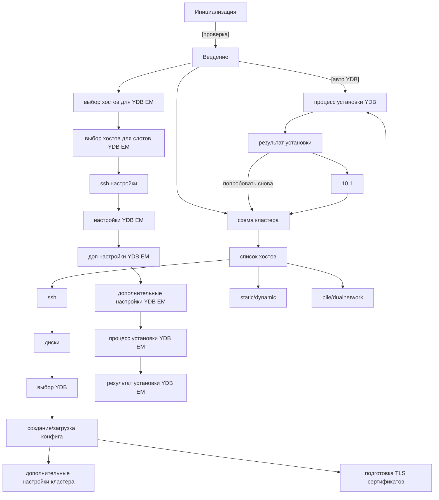

# Экраны

## 1. Введение [I]
Показываем краткую информацию о приложении, версию и выбор варианта установки:

- Автоматическая установка YDB (если есть текущие файлы ansible)
- Настройка установки YDB
- Автоматическая установка YDB EM (если есть текущие файлы ansible)
- Настройка установки YDB EM
[ ] - Есть доступ в интернет или нет

## 2. Выбор схемы кластера [I]
Краткое описание схем и выбор:
- 1-node-none (docker / бинарник ?)
- 3-nodes-mirror-3-dc
- 9-nodes-mirror-3-dc
- 6-nodes-bridge-2-dc
- 8-nodes-block-4-2

## 3. Ввод списка хостов (с разбивкой по датацентрам, 1:1 static:dynamic) [I]
## 3.1 Разбивка хостов по dynamic/static [II]
## 3.2 Указание дополнительных параметров (double network, pile для 2DC, тп) [III]

## 4. Ввод настроек ssh [I]
Логин:
Файл ключа/пароль:
Jump-host: (если FQDN не доступны напрямую, то обзательно запросить)
[ ] - Своя строка настроек

(формируем начальный ansible конфиг и проверяем доступность хостов, синхронность времени, список дисков на storage хостах)

## 5. Ввод дисков кластера [I]
Предварительно получение списка дисков (ansible) и отображение из для выбора
[ ] ручной ввод списка дисков

## 6. Выбор версии YDB для установки [I]
Подгрузка списка доступных версий, вывод их
Возможность указать свой дистрибутив или путь к бинарным файлам

## 7. Создание/загрузка конфига [I]
При создании нужно будет ввести обязательные значения, например:
- ydb_domain
- ydb_dbname
- ydb_user
- ydb_password
- ydb_cores_static
- ydb_cores_dynamic
- (v1/v2?)
[ ] Cноска "advanced" с остальными параметрами
При загрузке конфига, эти значения будут подсасываться сами
## 7.1 Дополнительные настройки [II]

## 8. Подготовка TLS сертификатов [I]
- Готовые
- Сгенерировать новые
- Без сертификатов ????????????????????????????? [III]
[dry run] [IV] [установка]

## 9. Процесс установки [I]

## 10. Результат установки [I]
Ссылка на UI, 
либо формирование файла для запроса поддержки в случае сбоя [II]
Так же интерпретация ошибки [II]
[ ] форматирование кластера [III]

## 10.1 Форматирование кластера [III]

## 20. Выбор хостов для YDB EM [II]
Указать хосты для установки YDB EM

## 21. Выбор хостов для слотов YDB EM [II]
Указать хосты для установки слотов баз данных
(если есть настройки YDB, то взять список dynamic нод)

## 22. Ввод настроек ssh [II]
Логин:
Файл ключа/пароль:
Jump-host: (если FQDN не доступны напрямую, то обзательно запросить)
[ ] - Своя строка настроек

## 23. Настройки YDB EM [II]
Параметры подключения к базе YDB (существующей)
(если есть настройки YDB, то взять из них)
Если YDB нет, то идем на п.2

## 24. Дополнительные настройки YDB EM [III]

## 25. Подготовка TLS сертификатов [II]
- Готовые для YDB / YDB EM
- Сгенерировать новые только для хостов YDB EM
- Без сертификатов ?????????????????????????????
[dry run] [установка]

## 26. Процесс установки [II]

## 27. Результат установки [II]
Ссылка на UI, либо формирование файла для запроса поддержки в случае сбоя
Так же интерпретация ошибки
[ ] форматирование кластера [III]

