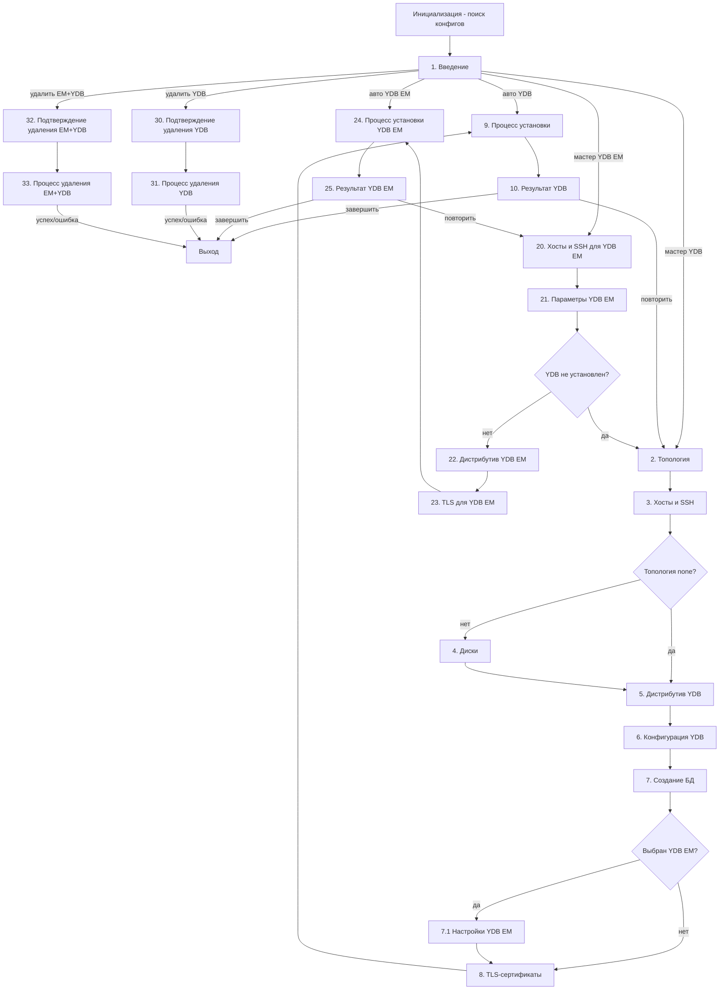

# Экраны — Вторая итерация

## Общий лейаут

- **Левая панель (Sidebar):** Список шагов со статусами:
  - 🔴 Ошибка
  - 🟢 Готово
  - 🔵 Активен
  - 🟡 Кликабелен, но не заполнен
  - ⚪ Неактивен (недоступен)
- **Верхняя панель (Header):**
  - Логотип и название инсталлятора слева
  - Переключатель языка интерфейса справа
- **Нижняя панель (Footer):**
  - Кнопка «Назад» слева
  - Кнопка «Далее» справа (неактивна до прохождения валидации текущего шага)
- **Центральная область:** Контент шага.

**Единая колонка контента:** Header, центральная область и footer выровнены по одной центрированной колонке — 960px внешняя ширина, 880px полезная (токены `--content-max-width` / `--content-gutter` и класс `.layout-column` в `ui/src/styles/app.css`). Отдельные экраны не задают собственную максимальную ширину — все шаги визуально выровнены друг относительно друга.

При наличии в директории запуска файлов `inventory.yaml` и/или `config.yaml` — поля автозаполняются на соответствующих шагах. При отсутствии файлов генерируются шаблонные версии с минимальными значениями при запуске инсталлятора.

---

## Экран 1: Введение

**Назначение:** Приветствие, выбор режима работы инсталлятора, проверка окружения.

**Содержимое:**
- Заголовок и версия инсталлятора.
- Блок выбора режима установки YDB:
  - **Автоматическая установка YDB** — активна, если в директории запуска найдены `inventory.yaml` и `config.yaml`.
  - **Настройка установки YDB** — пошаговый мастер.
- Блок выбора режима установки YDB EM:
  - **Автоматическая установка YDB EM** — активна, если найдены конфигурационные файлы YDB EM.
  - **Настройка установки YDB EM** — пошаговый мастер.
- Блок удаления:
  - **Удаление YDB** — переход к экрану 30 (полное удаление YDB).
  - **Удаление EM+YDB** — переход к экрану 32 (полное удаление YDB EM и YDB).
- Чекбокс «Есть доступ в интернет».
- Блок проверки зависимостей: Python (версия), Ansible (версия), ansible коллекция.
  - Для каждой зависимости отображается статус: ✅ установлено / ❌ не найдено
  - При отсутствии зависимости доступны три варианта действий:
    1. **Получить инструкцию** - раскрывается блок с командами установки для текущей ОС
    2. **Установить автоматически** - кнопка запускает установку через sudo (требует подтверждения)
    3. **Пропустить** - продолжить без установки (с предупреждением о возможных проблемах)

**Автозаполнение:** Если найдены `inventory.yaml` / `config.yaml` — предлагается автоматический режим.

**Логика перехода:** Выбран хотя бы один режим; при выборе установки — проверка зависимостей пройдена (или предупреждение принято); при выборе удаления — переход без проверки зависимостей.

---

## Экран 2: Выбор топологии

**Назначение:** Выбор схемы развёртывания кластера YDB.

**Содержимое:**
- Список топологий с описанием, требованиями и схематичной иллюстрацией:
  - **none** — одиночный узел (localhost), без дисков. Для разработчиков и студентов.
  - **mirror-3-dc (v1)** — зеркалирование между 3 ДЦ, минимум 3 узла, 9 дисков.
  - **block-4-2 (v1)** — блочное кодирование 4+2, минимум 8 узлов, 8 дисков.
  - **bridge-2-dc (v2)** — мост между 2 ДЦ; требует выбора внутренней топологии: none / mirror-3-dc / block-4-2.
- При выборе `bridge-2-dc` — появляется вложенный выбор внутренней топологии.

**Автозаполнение:** При наличии конфига — топология определяется автоматически. У каждой топологии свой стейт со связанными данными. При перевыборе топологии, конфиг автоматически меняется под нее, а введенные ранее данные, связанные со старой топологией (например таблица хостов), убираются из полей, при этом сохраняются в отдельный стейт топологии, чтобы при переключении обратно на нее, поля заполнялись старыми данными автоматически.

Если пользователь меняет топологию уже имея конфиги другой - нужно предупреждение.

**Логика перехода:** Топология выбрана; для `bridge-2-dc` — выбрана внутренняя топология.

---

## Экран 3: Хосты и SSH

**Назначение:** Ввод списка storage-узлов с разбивкой по ДЦ и настройка SSH-доступа.

**Содержимое:**

### SSH-настройки

- Логин пользователя (по умолчанию: `root`).
- Переключатель типа аутентификации: SSH-ключ / Пароль.
  - SSH-ключ:
    - Чекбокс «Указать приватный ключ»: дополнительное поле пути до файла ключа или вставки текста ключа.
  - Пароль: скрытое поле ввода.
- Чекбокс «Использовать Jump-host»; поле FQDN/IP Jump-host (обязательно, если хосты недоступны напрямую).
- Расширенные настройки: чекбокс «Своя строка настроек SSH» (открывает текстовое поле).

### Таблица хостов

- Динамические таблицы по каждому ДЦ (количество ДЦ определяется топологией).
- Столбцы: `#`, `FQDN (hostname)`.
- Кнопка «+ Добавить хост» под каждой таблицей. Кнопка «X» для удаления хоста напротив строки.
- **Кнопка «Загрузить из файла»** — импорт списка хостов из текстового файла (один FQDN/IP на строку); хосты распределяются по ДЦ в порядке следования таблиц.
- Для топологии `bridge-2-dc` — дополнительный вопрос о `pile` (принадлежность к стойке).
- Для топологии `none` — поле ввода localhost или IP одного узла.

### Проверка хостов

- Кнопка «Проверить доступность хостов».
- Результаты проверки:
  - Доступность (SSH).
  - Синхронизация времени (предупреждение при расхождении > порога).
  - Наличие Python нужной версии.
  - Количество найденных дисков (pre-scan для следующего шага).

**Автозаполнение:** Поля хостов и SSH-параметры берутся из `inventory.yaml`, если он найден. Значения внутри `inventory.yaml` автоматически заполняются во время заполнения полей хостов и SSH-параметров.

**Логика перехода:** Все хосты прошли проверку доступности и SSH-соединения.

---

## Экран 4: Диски

**Назначение:** Выбор дисков для storage-узлов.

> Экран пропускается, если выбрана топология **none**.

**Содержимое:**
- Список дисков, которые идентичны по характеристикам и есть на каждом хосте.
- Для каждого диска:
  - Чекбокс выбора.
  - Устройство (`/dev/sdX`, `/dev/nvmeX`).
  - Тип (HDD / SSD / NVMe).
  - Размер.
  - Статус (свободен / смонтирован / содержит ФС — с предупреждением об уничтожении данных).
- Опция «Ручной ввод дисков»

**Автозаполнение:** Чекбоксы выбранных дисков берутся из `inventory.yaml`, если он найден. При выборе дисков, `inventory.yaml` автоматически заполняется во время выбора.

**Логика перехода:** У каждого storage-узла выбран хотя бы один диск, объем выбранных дисков больше 300гб на 1 хосте (больше 900гб суммарно).

---

## Экран 5: Дистрибутив YDB

**Назначение:** Выбор версии YDB и источника дистрибутива.

**Содержимое:**
- Переключатель источника: **Официальный дитрибутив** / **Локальные файлы**.
  - Репозиторий: выпадающий список версий (загружается асинхронно при наличии интернета).
  - Локальные файлы: поля ввода путей к:
    - YDB package (архив `.tar.gz`)
    - Опционально:
      - `ydb` CLI (бинарный файл)
      - `ydbd` (бинарный файл)
      - `ydbops` (бинарный файл)
      - `dstool` (бинарный файл)
- Валидация: проверка существования файла и контрольной суммы.

**Автозаполнение:** Пути берутся из `inventory.yaml`, если они там указаны. При заполнении полей, `inventory.yaml` автоматически обновляется.

**Логика перехода:** Версия выбрана из репозитория или указан и валидирован путь к локальному пакету.

---

## Экран 6: Конфигурация YDB

**Назначение:** Настройка параметров кластера YDB.

**Содержимое:**
- Обязательные параметры:
  - `ydb_domain` (строка)
  - `ydb_password` (пароль, с генератором)
  - `ydb_cores_static` (число, слайдер)
  - `ydb_enforce_user_token_requirement` (bool, по умолчанию: `false`)
  - `ydb_request_client_certificate` (bool, по умолчанию: `true`)
- Дополнительные параметры (раскрываемый блок «Расширенные настройки»):
  - `affinity`
- Индикатор ресурсов: доступно ядер на кластере / запрошено (предупреждение при превышении) + рекомендации.

**Автозаполнение:** Значения берутся из `inventory.yaml`, если он найден. При заполнении полей, `inventory.yaml` автоматически обновляется.

**Логика перехода:** Все обязательные поля заполнены и валидны.

---

## Экран 7: Создание баз данных

**Назначение:** Настройка одной или нескольких баз данных YDB и опциональная установка YDB EM.

**Содержимое:**

### Варианты конфигурации

- **Вариант 1:** Одна БД + YDB EM для управления базами
- **Вариант 2:** Одна БД (на все или определённые хосты)
- **Вариант 3:** Несколько БД (на разные хосты)

### Общие параметры БД

- `ydb_database_groups` (число групп хранения)
- `ydb_cores_dynamic` (ядра для dynamic-нод)

### Список баз данных

- Минимум одна БД. Кнопка «+ Добавить базу».
- Для каждой БД:
  - `ydb_dbname` (строка, обязательно)
  - Хосты для dynamic-нод (по умолчанию — все хосты из Экрана 3; можно указать подмножество или добавить новые)
  - Расширенные настройки: `affinity`

### Проверка

- Проверка доступности узлов dynamic-нод.
- Проверка достаточности CPU.

**Автозаполнение:** Значения берутся из `inventory.yaml`, если он найден. При заполнении полей, `inventory.yaml` автоматически обновляется.

**Логика перехода:** Хотя бы одна БД настроена; ресурсы валидны.

---

## Экран 7.1: Настройки YDB EM (опционально)

**Назначение:** Настройка YDB Enterprise Manager, если выбран Вариант 1 на Экране 7.

> Экран отображается только если на Экране 7 выбрана установка YDB EM.

**Содержимое:**
- Хост(ы) для YDB EM.
- Хосты для баз данных (слоты).
- Параметры YDB EM:
  - `ydb_em_cluster_balancer` (FQDN балансировщика / CP endpoint)
  - `ydb_em_frontend` (по умолчанию — первый storage-хост; можно указать FQDN балансировщика)
  - `ydb_em_az_locations` (если нет ДЦ от YDB)
  - `ydb_em_cp_presets` (набор пресетов; есть набор по умолчанию)
- Источник дистрибутива YDB EM:
  - Версия релиза (из репозитория) или локальные файлы:
    - `ydb_em_archive`
    - `ydb_em_meta_ui_archive`
    - `ydb_em_cp_binary`
    - `ydb_em_cp_agent_binary`
- **Проверка динамического конфига:** Если установка ведётся на готовый кластер — обязательная проверка наличия dynamic config; если отсутствует — предложение создать его автоматически.

**Автозаполнение:** Значения берутся из `inventory.yaml` (YDB EM), если он найден. При заполнении полей, `inventory.yaml` (YDB EM) автоматически обновляется.

**Логика перехода:** Все обязательные параметры заполнены; проверка dynamic config пройдена.

---

## Экран 8: TLS-сертификаты

**Назначение:** Подготовка TLS-сертификатов для межузловой коммуникации и клиентского доступа.

**Содержимое:**
- Переключатель: **Сгенерировать самоподписанные** / **Использовать готовые**.
  - Генерация:
    - Срок действия (дней).
    - Кнопка «Сгенерировать».
    - Отображение структуры сгенерированных файлов (`ca.crt`, `node-N.crt`, `node-N.key`).
  - Готовые:
    - Поле пути к папке с сертификатами.
    - Ожидаемая структура файлов.
    - Кнопка «Проверить».
    - Статус каждого файла (найден / не найден / невалиден).

**Автозаполнение:** Значения берутся из `inventory.yaml`, если он найден. При заполнении полей, `inventory.yaml` автоматически обновляется.

**Логика перехода:** Сертификаты сгенерированы или загружены и прошли проверку.

---

## Экран 9: Процесс установки

**Назначение:** Генерация config.yaml и выполнение установки с отображением прогресса.

**Содержимое:**
- Кнопка "Сгенерировать config.yaml" с валидацией соответствия `config.yaml` введенным значеням со статусами (соответствует, требует обновления, отсутствует)
- Разворачиваемое окно с сгенерированным/существующим config.yaml
- Общий прогресс-бар (процент + количество задач).
- Список задач с индивидуальными статусами:
  - ⚪ Ожидает
  - ⏳ Выполняется
  - ✅ Завершено
  - ❌ Ошибка
- Окно консольного вывода (с прокруткой и поиском).
- Кнопка «Стоп / Отмена» (с диалогом подтверждения; предупреждение о частично установленных компонентах).

**Логика экрана:**
- Навигация «Назад» и «Далее» заблокированы во время выполнения.
- При ошибке: процесс останавливается, отображается блок с описанием ошибки и рекомендациями; кнопка «Далее» заменяется на «К ошибке».
- При успехе: кнопка «Далее» становится активной.

---

## Экран 10: Результат установки

**Назначение:** Итоговый экран с результатом установки.

**Содержимое:**

### Успешная установка

- Зеленая надпись об успешной установке сверху.
- Сводка по кластеру: топология, версия YDB, домен, список хостов со статусами.
- Endpoint кластера (`grpcs://...`).
- Ссылка на YDB UI (не кнопка).

### Провал установки

- Красная надпись об ошибке сверху.
- Информация об ошибке: задача, хост, причина, рекомендации.
- Разворачиваемое окно логов.
- Путь к лог-файлу с кнопкой «Скопировать путь».

---

## Экран 20: Хосты и SSH для YDB EM

**Назначение:** Ввод хостов для установки YDB EM и настройка SSH-доступа (только в режиме мастера YDB EM).

> Экран используется в отдельном потоке установки YDB EM (без YDB).

**Содержимое:**

### SSH-настройки

- Логин пользователя (по умолчанию: `root`).
- Переключатель типа аутентификации: SSH-ключ / Пароль.
  - SSH-ключ:
    - Чекбокс «Указать приватный ключ»: дополнительное поле пути до файла ключа или вставки текста ключа.
  - Пароль: скрытое поле ввода.
- Чекбокс «Использовать Jump-host»; поле FQDN/IP Jump-host (обязательно, если хосты недоступны напрямую).
- Расширенные настройки: чекбокс «Своя строка настроек SSH» (открывает текстовое поле).

### Таблица хостов YDB EM

- Столбцы: `#`, `FQDN (hostname)`.
- Кнопка «+ Добавить хост». Кнопка «X» для удаления хоста напротив строки.

### Таблица хостов для слотов баз данных

- Столбцы: `#`, `FQDN (hostname)`.
- Кнопка «+ Добавить хост». Кнопка «X» для удаления хоста напротив строки.
- Примечание: если YDB уже установлен и его конфиг доступен — список dynamic-нод подтягивается автоматически.

### Проверка хостов

- Кнопка «Проверить доступность хостов».
- Результаты проверки:
  - Доступность (SSH).
  - Синхронизация времени (предупреждение при расхождении > порога).
  - Наличие Python нужной версии.

**Автозаполнение:** Поля хостов и SSH-параметры берутся из `inventory.yaml` (YDB EM), если он найден. Значения внутри `inventory.yaml` (YDB EM) автоматически заполняются во время заполнения полей пользователем.

**Логика перехода:** Указан хотя бы один хост для YDB EM и хотя бы один хост для слотов БД; все хосты прошли проверку доступности и SSH-соединения.

---

## Экран 21: Параметры YDB EM

**Назначение:** Настройка параметров YDB Enterprise Manager.

**Содержимое:**
- Параметры подключения к существующей базе YDB:
  - Endpoint YDB (`grpcs://...`) — обязательно.
  - База данных YDB (путь к БД) — обязательно.
  - Если конфиг YDB доступен — значения подтягиваются автоматически.
  - Если YDB не установлен — предложение перейти к установке YDB (переход на Экран 2).
- Параметры YDB EM:
  - `ydb_em_cluster_balancer` (FQDN балансировщика / CP endpoint)
  - `ydb_em_frontend` (по умолчанию — первый хост из Экрана 20; можно указать FQDN балансировщика)
  - `ydb_em_az_locations` (если нет ДЦ от YDB)
  - `ydb_em_cp_presets` (набор пресетов; есть набор по умолчанию)
- **Проверка динамического конфига:** Обязательная проверка наличия dynamic config на кластере YDB; если отсутствует — предложение создать его автоматически.

**Автозаполнение:** Значения берутся из `inventory.yaml` (YDB EM), если он найден. При заполнении полей, `inventory.yaml` (YDB EM) автоматически обновляется.

**Логика перехода:** Все обязательные параметры заполнены; проверка dynamic config пройдена.

---

## Экран 22: Дистрибутив YDB EM

**Назначение:** Выбор версии и источника дистрибутива YDB EM.

**Содержимое:**
- Переключатель источника: **Официальный дистрибутив** / **Локальные файлы**.
  - Официальный дистрибутив: выпадающий список версий YDB EM (загружается асинхронно при наличии интернета).
  - Локальные файлы: поля ввода путей к:
    - `ydb_em_archive` (основной архив YDB EM, обязательно)
    - Опционально:
      - `ydb_em_meta_ui_archive` (архив UI)
      - `ydb_em_cp_binary` (бинарник CP)
      - `ydb_em_cp_agent_binary` (бинарник агента CP)
- Валидация: проверка существования файлов.

**Автозаполнение:** Пути берутся из `inventory.yaml` (YDB EM), если они там указаны. При заполнении полей, `inventory.yaml` (YDB EM) автоматически обновляется.

**Логика перехода:** Версия выбрана из официального дистрибутива или указан и валидирован путь к локальному архиву.

---

## Экран 23: TLS-сертификаты для YDB EM

**Назначение:** Подготовка TLS-сертификатов **только для EM-хоста(ов)**.

**Содержимое:**
- Переключатель (pill, снаружи карточки): **Сгенерировать самоподписанные** / **Использовать готовые**.
  - Генерация:
    - Список EM-хостов, для которых будут созданы сертификаты.
    - Срок действия (дней).
    - Кнопка «Сгенерировать».
    - Структура: `ca.crt`, `<shortName>/node.crt`, `node.key`, `web.pem` в `certs-per-host`.
  - Готовые:
    - Поле пути к каталогу certs-per-host (`ydb_em_tls_dir`).
    - Кнопка «Проверить» (без auto-validate при вводе/загрузке).
    - Статус CA и файлов EM-хоста (найден / невалиден / pair match).

**Автозаполнение:** `ydb_em_tls_dir` из `90-inventory.yaml` (YDB EM). При изменении пути inventory обновляется.

**Логика перехода:** Сертификаты сгенерированы (режим generate) или прошли проверку (режим existing) для всех EM-хостов.

---

## Экран 24: Процесс установки YDB EM

**Назначение:** Генерация конфигурации и выполнение установки YDB EM с отображением прогресса.

**Содержимое:**
- Кнопка «Сгенерировать config.yaml» с валидацией соответствия `config.yaml` введённым значениям со статусами (соответствует, требует обновления, отсутствует).
- Разворачиваемое окно с сгенерированным/существующим `config.yaml`.
- Общий прогресс-бар (процент + количество задач).
- Список задач с индивидуальными статусами:
  - ⚪ Ожидает
  - ⏳ Выполняется
  - ✅ Завершено
  - ❌ Ошибка
- Окно консольного вывода (с прокруткой и поиском).
- Кнопка «Стоп / Отмена» (с диалогом подтверждения; предупреждение о частично установленных компонентах).

**Логика экрана:**
- Навигация «Назад» и «Далее» заблокированы во время выполнения.
- При ошибке: процесс останавливается, отображается блок с описанием ошибки и рекомендациями; кнопка «Далее» заменяется на «К ошибке».
- При успехе: кнопка «Далее» становится активной.

---

## Экран 25: Результат установки YDB EM

**Назначение:** Итоговый экран с результатом установки YDB EM.

**Содержимое:**

### Успешная установка

- Зеленая надпись об успешной установке сверху.
- Сводка: хосты YDB EM, хосты слотов БД.
- Ссылка на YDB EM UI (не кнопка).

### Провал установки

- Красная надпись об ошибке сверху.
- Информация об ошибке: задача, хост, причина, рекомендации.
- Разворачиваемое окно логов.
- Путь к лог-файлу с кнопкой «Скопировать путь».

---

## Экран 30: Подтверждение удаления YDB

**Назначение:** Сбор информации о кластере и подтверждение полного удаления YDB.

**Содержимое:**
- Заголовок «Удаление YDB».
- Блок информации об установленном кластере (автозаполняется из `inventory.yaml` / `config.yaml` если найдены):
  - Список хостов (с возможностью ввода вручную или загрузки из файла, если конфиги не найдены).
  - Топология (если известна).
  - Версия YDB (если известна).
- Блок SSH-настроек (аналогично Экрану 3): логин, аутентификация, jump-host.
- Блок предупреждения: ⚠ операция полного удаления необратима — будут удалены сервисы, данные на дисках, конфигурационные файлы и бинарные файлы YDB.
- Поле ввода подтверждения: пользователь должен ввести `DELETE` для активации кнопки.

**Автозаполнение:** Хосты и SSH-параметры берутся из `inventory.yaml`, если он найден.

**Логика перехода:** Введено слово `DELETE`; SSH-доступ к хостам проверен.

---

## Экран 31: Процесс удаления YDB

**Назначение:** Выполнение полного удаления YDB с отображением прогресса.

**Содержимое:**
- Общий прогресс-бар (процент + количество задач).
- Список задач с индивидуальными статусами (⚪ / ⏳ / ✅ / ❌):
  1. Остановка Dynamic nodes
  2. Остановка Storage nodes
  3. Удаление данных на дисках
  4. Удаление конфигурационных файлов
  5. Удаление бинарных файлов
  6. Финальная проверка
- Окно консольного вывода (с прокруткой и поиском).
- Кнопка «Стоп / Отмена» (с диалогом подтверждения).

**Логика экрана:**
- Навигация «Назад» и «Далее» заблокированы во время выполнения.
- При ошибке: процесс останавливается, отображается блок с описанием ошибки и рекомендациями.
- При успехе: отображается сообщение об успешном удалении; кнопка «Завершить» становится активной.

---

## Экран 32: Подтверждение удаления EM+YDB

**Назначение:** Сбор информации о компонентах и подтверждение полного удаления YDB EM и YDB.

**Содержимое:**
- Заголовок «Удаление EM+YDB».
- Блок информации об установленных компонентах (автозаполняется из конфигов если найдены):
  - Хосты YDB EM (с возможностью ввода вручную или загрузки из файла).
  - Хосты YDB (с возможностью ввода вручную или загрузки из файла).
  - Топология YDB (если известна).
  - Версии компонентов (если известны).
- Блок SSH-настроек: логин, аутентификация, jump-host.
- Блок предупреждения: ⚠ операция полного удаления необратима — будут удалены YDB EM, сервисы YDB, данные на дисках, конфигурационные файлы и бинарные файлы.
- Поле ввода подтверждения: пользователь должен ввести `DELETE` для активации кнопки.

**Автозаполнение:** Хосты и SSH-параметры берутся из `inventory.yaml` и `inventory.yaml` (YDB EM), если они найдены.

**Логика перехода:** Введено слово `DELETE`; SSH-доступ к хостам проверен.

---

## Экран 33: Процесс удаления EM+YDB

**Назначение:** Выполнение полного удаления YDB EM и YDB с отображением прогресса.

**Содержимое:**
- Общий прогресс-бар (процент + количество задач).
- Список задач с индивидуальными статусами (⚪ / ⏳ / ✅ / ❌), сначала YDB EM, затем YDB:
  1. Остановка YDB EM
  2. Удаление YDB EM (сервисы, файлы)
  3. Остановка Dynamic nodes YDB
  4. Остановка Storage nodes YDB
  5. Удаление данных на дисках
  6. Удаление конфигурационных файлов
  7. Удаление бинарных файлов
  8. Финальная проверка
- Окно консольного вывода (с прокруткой и поиском).
- Кнопка «Стоп / Отмена» (с диалогом подтверждения).

**Логика экрана:**
- Навигация «Назад» и «Далее» заблокированы во время выполнения.
- При ошибке: процесс останавливается, отображается блок с описанием ошибки и рекомендациями.
- При успехе: отображается сообщение об успешном удалении всех компонентов; кнопка «Завершить» становится активной.

---

## Навигационная схема

---

## Сводная таблица экранов

| № | Экран | Поток | Пропускается при | Автозаполнение |
|---|-------|-------|-----------------|----------------|
| 1 | Введение | Общий | — | Наличие конфигов в директории |
| 2 | Топология | YDB | Авторежим | `inventory.yaml` |
| 3 | Хосты и SSH | YDB | Авторежим | `inventory.yaml` |
| 4 | Диски | YDB | Топология `none` | `inventory.yaml` |
| 5 | Дистрибутив YDB | YDB | Авторежим | `inventory.yaml` |
| 6 | Конфигурация YDB | YDB | Авторежим | `inventory.yaml` |
| 7 | Создание БД | YDB | Авторежим | `inventory.yaml` |
| 7.1 | Настройки YDB EM | YDB | Если YDB EM не выбран | `inventory.yaml` (YDB EM) |
| 8 | TLS-сертификаты | YDB | Авторежим | `inventory.yaml` |
| 9 | Процесс установки | YDB | — | — |
| 10 | Результат | YDB | — | — |
| 20 | Хосты и SSH для YDB EM | YDB EM | Авторежим | `inventory.yaml` (YDB EM) |
| 21 | Параметры YDB EM | YDB EM | Авторежим | `inventory.yaml` (YDB EM) |
| 22 | Дистрибутив YDB EM | YDB EM | Авторежим | `inventory.yaml` (YDB EM) |
| 23 | TLS для YDB EM | YDB EM | Авторежим | `inventory.yaml` (YDB EM) |
| 24 | Процесс установки YDB EM | YDB EM | — | — |
| 25 | Результат YDB EM | YDB EM | — | — |
| 30 | Подтверждение удаления YDB | Удаление YDB | — | `inventory.yaml` |
| 31 | Процесс удаления YDB | Удаление YDB | — | — |
| 32 | Подтверждение удаления EM+YDB | Удаление EM+YDB | — | `inventory.yaml`, `inventory.yaml` (YDB EM) |
| 33 | Процесс удаления EM+YDB | Удаление EM+YDB | — | — |
